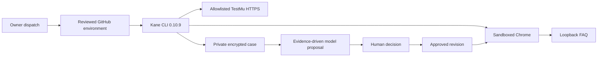

# Fieldnote Seed Library

An FAQ can contain the right answer and still hide it from every reader. Fieldnote is a small, synthetic seed-library page with exactly that defect. It gives a reviewer a concrete way to answer three questions: what the browser saw, what change a model proposed, and whether the same interaction worked after a person approved the change.

This standalone project was authored with Codex for the November 2026 Kane CLI event. It uses no Savoir platform source, customer records, production services or database migrations. Its private case record tracks the provider's reported credits. The pre-existing Savoir Meter is separate.

**Status at preparation:** Both page revisions and the workflow are implemented. Hosted qualification, live title and FAQ observations, actual Kane consumption, a live model decision and a verified repair are pending. A local preview of the repaired control is a design preview. A public before/after report can be produced only from the two linked private browser records.

## Run the page

Install Node.js 22. From the repository root run the following command and visit `http://127.0.0.1:4318/`. No dependencies, credentials or database are required.

```sh
node fixture.mjs initial
```

Click **Where do envelopes go?**. The original button has no action and the answer stays hidden. Stop the process before running `node fixture.mjs approved` to preview the proposed native disclosure. The live recheck serves that revision only after it validates the human approval.

## How the verification works



Kane attaches to the running Chrome instance over local CDP. Browser and CLI have separate OS identities, private temporary directories, CPU, memory and process limits. The network namespace can reach the fixture and an SNI-filtered TLS gateway. Its forwarding path is blocked. Qualification probes the real Chrome sandbox, PNG capture, allowed and denied connections before enabling account checks. The hosted job starts from a fresh VM and runs one selected stage.

The original and corrected FAQ share an objective hash. A confirmed defect needs the missing-answer observation, a consistent failed assertion, a screenshot from the failed step, a readable archive and actual credit usage. A successful recheck requires the expected answer and screenshot evidence. The model receives synthetic observations and screenshot hashes. It chooses a constrained change or manual review. A person approves the exact proposal hash. The encrypted case preserves each revision and decision while the runner is offline.

## Configure the public repository

1. After publication approval, place only this project's reviewed files in the root of **md-abunayem/savoir-brand_visibility_and_aeo_geo_platform**, on **main**. Set a ruleset for `main`, require review for workflow changes, restrict write access and disable admin bypass where available. In **Settings → Actions → General**, use a read-only default token, disallow creation/approval of pull requests by Actions and keep fork access to secrets disabled. The workflow accepts only owner-initiated manual dispatches on this repository's main branch. It has no PR trigger, arbitrary target, artifact upload or automatic retry.
2. In **Settings → Environments → New environment**, create **fieldnote-reviewed**. Restrict deployment to `main` and configure a trusted required reviewer. In that environment's **Secrets** add `LT_USERNAME`, `LT_ACCESS_KEY` and `VERIFICATION_EVIDENCE_KEY` using the web form. The first two belong to the dedicated TestMu development identity. The third is a new randomly generated 32-byte key encoded as standard Base64. Keep a private backup. Never place values in issues, workflow inputs, logs or a recording. [GitHub environments](https://docs.github.com/en/actions/how-tos/deploy/configure-and-manage-deployments/manage-environments) · [TestMu authentication](https://www.testmuai.com/docs/kane-cli-authentication)
3. In the repository owner's **Billing and licensing → Budgets and alerts**, confirm that additional spend is blocked. Use only the standard `ubuntu-24.04` runner. Public standard compute is free. This entry uses neither Actions artifacts nor an Actions cache. Confirm the actual runner label in the job setup log. [GitHub Actions billing](https://docs.github.com/en/billing/concepts/product-billing/github-actions)
4. The TestMu administrator checks the dedicated identity's group, available balance, grant expiry, parent **Credits → Auto-reload** disabled, and **Budgets → Groups** cap/used/reset or the effective usage-blocking threshold in **Alerts**. Require confirmation that settlement, private uploads and any negative balance cannot incur an additional monetary charge. Obtain the **exact evidence upload hostname** and verify that provider-side evidence stays in the approved private project. Enter only that hostname as the environment variable `UPLOAD_HOST`. The CLI needs no HyperExecute subscription for this workflow. [Credit controls](https://www.testmuai.com/support/docs/credits-management/)
5. From **Actions → Fieldnote browser verification → Run workflow**, run **qualify**. It uses no provider credentials or browser credits. Run **account** for a real dedicated basic-auth identity and balance read. The public log reports success only. To retain the number, configure the private output for `account.case` as below and inspect the downloaded encrypted record locally.

## Private storage and one-run approval

Use an **already approved private HTTPS object store with a verified $0 allowance**. The owner must be able to create short-lived, object-specific signed GET and PUT URLs with ordinary binary bodies. PUT must support atomic `If-None-Match: *` and return HTTP 412 on a collision. Configure the provider to accept that signed header. Anonymous reads must fail. Confirm encryption, retention and available space for all stages before arming a run. A compatible private store is an outstanding prerequisite.

Set `VAULT_HOST` to its exact TLS hostname. Use the environment secrets below, scoped to the applicable run. Paths end in `/fieldnote-v1/<leaf>`. Objects may reside under a private bucket prefix. These capabilities belong to the trusted runner supervisor. The browser and Kane process receive none of them.

| Environment secret | Authorized object and permission |
| --- | --- |
| `VAULT_PROBE_URL` | Create `probe-<GitHub run ID>`. The job writes twice and requires rejection of the second write. Set it while the job awaits environment review. |
| `ADMISSION_URL` | Create `<stage>.lock` once per stage. Preserve the lock across all dispatches, including failed ones. |
| `CASE_OUTPUT_URL` | Create `<stage>.case` once. The application encrypts originals and diagnostics before upload. |
| `CASE_INPUT_URL` | Read `title.case` for the original FAQ, or `approved.case` for the recheck. Title needs no input object. |

Before releasing a browser job, set protected environment variables `APPROVED_SHA` to the reviewed full commit, `APPROVED_STAGE` to the exact stage, `APPROVED_RUN` to its workflow **run number**, and `ZERO_CHARGE=confirmed` only after the billing and storage checks. The number appears as **#N**; the run **ID** appears in the Actions URL. Prepare the number and SHA before dispatch. Provide the run-ID-specific probe secret before approving the waiting environment. The permission covers one run of this new fixture. Clear the approval variables afterward. Keep the same commit throughout the demonstration.

## Demonstrate and inspect

1. Authorize **title**. Require a successful real title observation and validated screenshots. Download `title.case` privately. With the evidence key available in a local environment, run `node case.mjs inspect title.case` to read the actual result and usage.
2. Independently authorize **faq-before** with the title record as input. Inspect the downloaded `faq-before.case`. Only a screenshot-backed assertion failure with the missing answer is eligible for a proposal. An infrastructure failure ends this attempt.
3. On the private review machine configure a dedicated `GEMINI_API_KEY`, an available `GEMINI_MODEL` and `FREE_MODEL_APPROVED=yes` **only after verifying an authorized zero-charge model quota and overage controls**. In the private case directory run `node /path/to/case.mjs propose faq-before.case proposal.case`. This makes one genuine model call and retains its decision, evidence reference and reported usage. Keep the admission marker beside the original. A manual-review decision stops the sequence. [Gemini generation API](https://ai.google.dev/api/generate-content)
4. The human reviewer runs `node /path/to/case.mjs approve proposal.case approved.case`, inspects the displayed change and hashes, and types the requested approval. Upload the resulting encrypted file to the approved private location as `approved.case` using the vault owner's authenticated interface. Keep the original, proposal and approval files. No raw images or credentials belong in the public repo.
5. Independently authorize **faq-after** against that approval. The fixture applies the selected disclosure for this revision. Inspect the resulting private `faq-after.case`. Locally run `node /path/to/case.mjs compare approved.case faq-after.case` to produce a sanitized before/after report with revision and archive hashes, screenshot counts and reported credits. Review its contents and obtain permission before sharing it.

If a job times out, an upload fails, or evidence is inconclusive, inspect the existing admission marker, private object and TestMu execution history. A runner lost before private upload can leave only the admission marker and provider-side evidence. Keep that case unresolved. The public job has no recovery action that launches Kane again.
# Development title and encrypted CI evidence

The **Fieldnote development title** workflow supports a single synthetic title assertion on the qualified runner. First select **qualify-artifact**. It exercises admission and authenticated encryption with a disposable key, uploads one encrypted diagnostic for seven days, and checks the downloaded bytes. It uses no provider credentials. Confirm the repository's artifact usage fits the approved monetary budget before dispatch.

After separate authorization for a live attempt, select **dev-title** on the reviewed main commit. While deployment review is pending, set the protected environment variables `APPROVED_DEV_RUN_ID` to the numeric ID in the workflow run URL, `APPROVED_SHA` to that commit, and `APPROVED_STAGE` to `dev-title`. Set `ZERO_CHARGE=confirmed` only after checking the applicable billing controls. Supply the exact verified provider evidence upload hostname in `UPLOAD_HOST`. The protected environment supplies the existing TestMu credentials and `VERIFICATION_EVIDENCE_KEY`. Approve only that deployment. Each approval authorizes one first-attempt run of up to three steps and 90 seconds. A new dispatch requires a new approval.

Download the artifact privately and use the existing case inspector with the evidence key. Only the encrypted case file belongs in Actions artifacts. Verify the execution ID, observed title, screenshot hashes, actual reported usage, fixture revision and commit before demonstrating the result. Retain an inconclusive case for diagnosis. This development route applies only to the title fixture.
